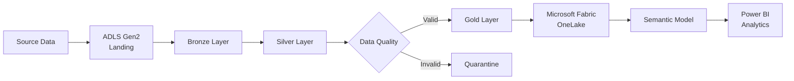

# 🚀 SRID Azure Data Platform

### End-to-End Azure Data Engineering & Analytics Platform

**Terraform • ADLS Gen2 • Azure Data Factory • Databricks • Delta Lake • Microsoft Fabric • Power BI**

 

An enterprise-style cloud data platform demonstrating infrastructure as code,  
medallion architecture, data quality engineering, dimensional modelling,  
semantic modelling and interactive business analytics.

---

> **Data:** This project uses synthetically generated business data designed to simulate a South African industrial distribution company.

---

## ✨ Project Highlights

- ☁️ Azure infrastructure provisioned using **Terraform**
- 🗄️ Multi-layer **ADLS Gen2 medallion architecture**
- ⚙️ Data transformation using **Databricks, PySpark and Delta Lake**
- ✅ Data quality validation with a dedicated **quarantine layer**
- 🔐 Azure-native security using **RBAC, Entra ID and Key Vault**
- 📊 Business-ready **Gold dimensional models**
- 🔗 Integration with **Microsoft Fabric and OneLake**
- 🧠 Reusable **Power BI semantic model and DAX measures**
- 📈 Four-page interactive executive analytics report
- 📁 Source-controlled engineering artefacts in **GitHub**

---

# 🏗️ Architecture

### Data Flow

**Source → Landing → Bronze → Silver → Gold → Fabric → Semantic Model → Power BI**

The platform separates raw ingestion, validated data and business-ready analytics into independent layers so each stage can be governed, monitored and maintained separately.

---

# 🧰 Technology Stack

![Databricks](https://img.shields.io/badge
